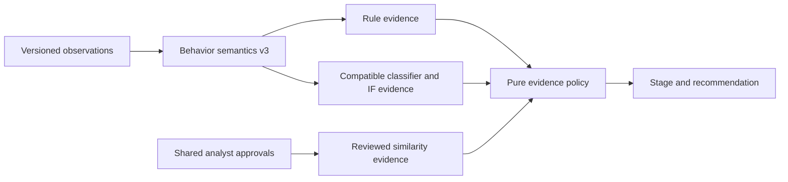

# Task 03 — detection semantics and alert policy

This change separates behavioral observations, detector evidence and response recommendations before real telemetry is integrated. It is an offline/simulation baseline, not a production detector. Its base is Task 02 commit `0e69dc1`; Task 02's published seed-20261027 final holdout is retired and was not read or used to select these policies.



The watcher, event API, symptom compatibility wrapper and ablation evaluator use the same pure policy engine. It never terminates a process, isolates a host, blocks writes or performs destructive actions. A cooperative stop request can only stop synthetic event generation, requires attributed corroboration and a successful model-service response, and always reports `containment_executed=false`. Even a real-source record receiving a containment recommendation creates no sandbox stop file. Historical untyped simulation generators remain runnable and safe; their assertions alone no longer authorize a cooperative stop.

## Feature semantics

`multi_directory_impact` is now `min(distinct (host, normalized parent directory) with possible impact / 15, 1)`. `observed_directory_count` separately counts activity directories. Thirty reads, touches or renames in thirty directories produce no impact. Thirty possible-impact files in one directory contribute exactly 1/15, not 1. The spread report uses the same impact-directory set.

Read, touch, create, modify, rename and delete counts are distinct. `mass_file_modification` includes modifications/scrambles, not reads, metadata touches, ordinary renames or extension-change assertions. A deletion or rename is observable activity until additional context indicates possible destructive impact. File locks/scrambles/notes are possible-impact assertions, not proof that ransomware ran.

For >=2 typed timestamps, generic activity features use observed-span density (events/minute divided by 100, clipped to [0,1]; span floored at one second). This is a descriptive burst proxy, not a measured endpoint exposure interval. Sparse windows and variable sampling change its meaning. Legacy simulations retain explicitly marked count proxies. Density preserves timing variability that saturated count proxies discarded; exact duplicate observations still remain in one split group. The first count-proxy generator attempt could not form all-profile independent partitions because saturated features joined entire workload groups; it failed before model fitting/scoring. No thresholds were optimized using final-test or validation outcomes.

Entropy requires appropriately typed observations, units, sampling and operation. A 7.2 bits/byte threshold marks high entropy as suspicious, not destructive. Legacy untyped entropy extras are ignored; explicit legacy entropy-write names remain unmeasured assertions. Network polling is activity; suspected beaconing and possible transfer require separate referenced indicators, and C2/exfiltration feature names require explicit high-confidence upstream assertions. Ordinary process creation, rare-name labels, generic memory anomalies and path counts no longer invent injection, document damage or process-tree evidence. Unsupported features remain zero/unavailable; zero does not prove absence.

## Evidence and stages

Four explicit categories appear in alert schema 3: `observed_activity`, `suspicious_behavior`, `possible_impact`, and `corroborated_high_confidence_detection`. Operation counts and attribution accompany them. Individual rule, classifier, active anomaly and reviewed-signature records include availability, hits, raw scores/probabilities where supplied, compatibility and shadow information. Review does not erase a positive detector output or change its original label/score. An API failure remains separately visible and cannot authorize a sandbox stop.

| Stage | Default `evidence_balanced` decision |
| --- | --- |
| Monitor | Only generic activity, including high-volume reads/writes/renames/polling |
| Suspicious activity / evidence collection | Specific suspicious behavior, possible impact alone, or one usable model signal |
| Analyst alert | Possible impact plus rule/model/reviewed-signature evidence, or classifier+IF consensus with specific suspicious context |
| Containment recommendation | >=3 modifications and >=3 impacted paths attributed to one host/process, destructive-content indicator plus note/recovery-tamper indicator, >=2 referenced observations and observation/indicator confidence >=0.8 |

Classifier and IF consume shared features, so consensus is not independent evidence of destructive impact. Consensus plus specific suspicious context can warrant review, never containment by itself. Generic volume alone cannot create an analyst alert, even if both models agree. Corroborating references also do not prove independent sensors; trusted enrichment and source authentication remain future work.

Alternatives are explicitly defined: `corroboration_only` requires impact with rule/signature evidence for an analyst alert; `analyst_sensitive` also alerts on a lone usable detector with specific suspicious context, or possible impact. All alternatives share the same containment gate. The default name was chosen semantically, not as a score-selected winner. An invariant review after an exploratory development/validation run added the shared context guard against model escalation from generic volume alone. Policy logic therefore has been developed using these partitions; they are not an independent confirmation set. No numeric detection threshold was optimized and the retired final holdout was not accessed.

Compatibility `policy` strings remain for dashboards (`monitor_only`, `early_warning`, `analyst_review`, `protective_lockdown`), but `stage`, evidence and `containment_recommended` are authoritative. A historical `unknown_risk` summary or supplied policy string cannot independently escalate a decision. The old `risk_score` is a display heuristic, not a policy stage or calibrated probability.

## Artifact and approval compatibility

Feature vocabulary/schema 2 and feature *semantics* 3 are separately versioned. Metadata without `feature_semantics_version` is treated as legacy 2. New inputs must explicitly declare version 3; v2 or incompatible models retain their raw outputs as shadow-only evidence and cannot influence active policy. Existing active models are not overwritten or promoted. The development benchmark trains isolated v3 candidates; it does not install them.

Training rejects mixed semantics, records the version and normalization, and reviewed v3 cases cannot enter a v2 base dataset. Re-extract and review a consistently versioned dataset before candidate training. Adding a version number to old proxy rows does not establish measurement compatibility. The external reviewed-source admission workflow remains the v2 contract and has not been validated against captured v3 endpoint telemetry.

One shared analyst review/digest record still gates signatures and learning. Feature-version changes invalidate approval, as do changes to events, symptoms or damage. Signatures are compared by re-extracted observations and rates; approved similarity is evidence for review, never an unconditional lockdown override. No automatic learning/promotion occurs.

Task 02's exact historical feature/rule/policy functions are isolated in `benchmark/legacy_v2.py`, solely for offline historical replay. Live components do not import that snapshot. Its documented defects are intentionally preserved for comparisons; it is not a second deployable policy. Published Task 02 reports and PR #1 reports remain unchanged. Reproducing the original Task 02 frozen fingerprints requires checkout `0e69dc1`; current code correctly rejects reuse of its retired holdout.

## Development/validation protocol

Run from the repository root with the existing pinned environment:

```bash
PYTHONPATH=src python -m symptom_ai.benchmark.policy_development \
  --output /tmp/policy-development-new --seed 310026 --sessions-per-profile 30
PYTHONPATH=src python -m unittest discover -s tests -v
PYTHONPATH=src python scripts/verify_integration.py --summary /tmp/integration-summary.json
PYTHONPATH=src python scripts/verify_quality_baseline.py
```

The output directory must be new. Protocol/configuration/implementation hashes are written before fitting; model/input/prediction checksums and dependency versions accompany the report. There is deliberately no final-test partition or final-test reader. The 70/30 grouping preserves endpoint/session/source-file and exact-duplicate relationships. Eight benign profiles cover bulk operations, backups, compression, updates, sync, builds, administration and polling. Three positive profiles exercise note, recovery-tamper and ambiguous impact, with two warmup windows, two pre-impact windows and four impact windows. Each profile has 30 independent RNG sessions/endpoints and eight 60-second simulated windows.

RF/XGB specifications are unchanged; classifier selection uses validation macro-F1 and IF calibration uses benign validation at nominal 5% FPR. Thus validation results are developmental and conditional on model selection/calibration, not an unbiased final performance estimate. The CI's historical Task 02 smoke benchmark uses disposable seed 73 and legacy scoring; it does not access the published holdout or tune the Task 03 policy.

Recorded metrics, profile results and limitations are in [the development report](../reports/detection_semantics/report.md), with [machine-readable results](../reports/detection_semantics/report.json) and [protocol](../reports/detection_semantics/protocol.json). Large generated logs, models and per-window predictions stay ignored under `reports/detection_semantics/artifacts/`. No external telemetry, genuine ransomware data or real endpoint exposure is available, so real-world FPR, alert rates and latency improvements are not claimed.
